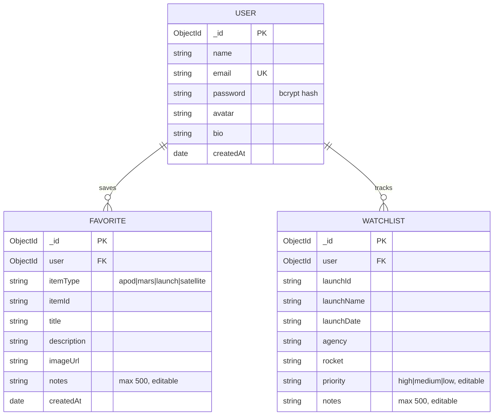

# CosmicHorizon – Interactive Space Exploration & Satellite Tracking


CosmicHorizon is a full-stack, real-time web application engineered to track space objects, orbital missions, and astronomical phenomena. It features live International Space Station (ISS) telemetry with interactive Leaflet mapping, upcoming global rocket launch manifests with countdown clocks, NASA deep-space imagery and asteroid tracking, and user persistence for favorites and watchlists.

---

## 🚀 Key Features

* **Real-Time ISS & Satellite Tracker**:
  * Live geographic coordinates (Latitude / Longitude / WGS84).
  * Real-time orbital speed (~27,600 km/h) and altitude (~420 km LEO).
  * Auto-refreshing poll mechanism (every 3.5 seconds) with manual pause/resume.
  * Interactive dark-mode map powered by **Leaflet** with custom pulsing SVG spacecraft markers and historical trajectory trails.
* **Global Rocket Launch Manifest**:
  * Real-time launch schedules via Launch Library 2 (The Space Devs).
  * Countdown timer down to the second (T-minus).
  * Search and multi-criteria filters by launch provider (SpaceX, NASA, Rocket Lab, ULA, ISRO, Arianespace) and flight readiness status (Go, TBD, Hold).
  * Comprehensive modal telemetry with mission overviews, target orbits, and pad locations.
* **NASA Deep Space Observatory**:
  * **Astronomy Picture of the Day (APOD)**: High-resolution daily space photograph/video with calendar date archive and full HD viewer modal.
  * **Mars Surface Rovers**: Photo gallery from Perseverance and Curiosity, filtered by Martian Sol and camera type (FHAZ, RHAZ, MAST, NAVCAM).
  * **Near-Earth Asteroid Radar (NEO)**: Close-approach asteroid tracking with relative velocities, estimated diameters, miss distances, and hazardous alert badges.
* **User Authentication & Mission Persistence**:
  * Secure registration and login using encrypted passwords (`bcryptjs`).
  * Stateless token authorization (`jsonwebtoken` / JWT).
  * Personal **Mission Watchlist** for upcoming rocket launches.
  * Celestial **Bookmarks & Favorites** for APOD and Martian imagery.
  * Dedicated **Astronaut Dashboard** with metrics overview, next countdown widget, and editable user profile.

---

## 🛠️ Architecture & Technology Stack

```
                          ┌─────────────────────────┐
                          │   React 19 + Vite UI    │
                          │   Tailwind CSS + Lucide │
                          │     Leaflet Dark Map    │
                          └────────────┬────────────┘
                                       │ REST / JWT
                                       ▼
                          ┌─────────────────────────┐
                          │    Express.js Server    │
                          │   MVC + Service Layer   │
                          │   In-Memory API Cache   │
                          └──────┬────────────┬─────┘
                                 │            │
            ┌────────────────────┘            └────────────────────┐
            ▼                                                      ▼
 ┌──────────────────────┐                               ┌──────────────────────┐
 │   MongoDB Database   │                               │    External APIs     │
 │  - Users             │                               │  - WhereTheISS.at    │
 │  - Favorites         │                               │  - Launch Library 2  │
 │  - Watchlists        │                               │  - NASA Open APIs    │
 └──────────────────────┘                               └──────────────────────┘
```

* **Frontend**: React 19, Vite, Tailwind CSS, Lucide Icons, Leaflet, Axios, React Router 7.
* **Backend**: Node.js, Express.js, Mongoose ODM, JWT, BcryptJS.
* **Database**: MongoDB (Local or Atlas).
* **Architecture Pattern**: MVC with a dedicated Service Proxy Layer to safeguard third-party API keys and cache external requests against rate limiting (HTTP 429).

---

## 📂 Project Directory Structure

```
CosmicHorizon Project/
├── client/                               # React Vite Frontend Application
│   ├── src/
│   │   ├── components/
│   │   │   ├── common/                   # Reusable UI (Modal, Loader, Badge, ProtectedRoute)
│   │   │   ├── layout/                   # Navbar, Footer
│   │   │   ├── tracker/                  # ISSMap, CoordinatesDisplay
│   │   │   ├── launches/                 # LaunchCard, LaunchFilter, CountdownTimer
│   │   │   └── nasa/                     # ApodViewer, MarsGallery, NeoRadar
│   │   ├── context/                      # AuthContext, NotificationContext
│   │   ├── pages/                        # Home, Tracker, Launches, NASA, Dashboard, Login, Register, 404
│   │   ├── services/                     # Axios API clients (auth, space, user)
│   │   ├── App.jsx                       # Master Routing and Context tree
│   │   └── main.jsx                      # Vite entry point
│   ├── .env.example                      # Client environment configuration
│   └── tailwind.config.js                # Custom space-themed color scheme & glow utilities
│
├── server/                               # Node.js + Express REST API
│   ├── src/
│   │   ├── config/db.js                  # MongoDB Mongoose connection
│   │   ├── controllers/                  # Auth, Tracker, Launch, NASA, and User controllers
│   │   ├── middleware/                   # JWT auth guard, Global error handling, 404
│   │   ├── models/                       # User, Favorite, Watchlist Mongoose schemas
│   │   ├── routes/                       # Auth, Space, User REST routes
│   │   ├── services/                     # ISS, Launch, and NASA fetchers with resilient caching
│   │   └── utils/                        # Response formatters, Token generator, Mock fallbacks
│   ├── testAuth.js                       # Automated Auth integration test suite
│   ├── testSpace.js                      # Automated Space API test suite
│   ├── testUser.js                       # Automated Persistence & Dashboard test suite
│   ├── seedDemo.js                       # Viva presentation database seeder
│   └── server.js                         # Application entry listening on port 5000
│
└── README.md                             # Academic and technical documentation
```

---

## ⚡ Quick Start Guide

### 1. Prerequisites
* **Node.js** (v18.x or newer)
* **MongoDB** (running locally on port `27017` or a MongoDB Atlas URI)

### 2. Backend Setup
```bash
cd server
npm install

# Start development server
npm run dev
# OR start standard server
npm start
```
The server will run at: `http://localhost:5000`  
Health check endpoint: `http://localhost:5000/api/health`

### 3. Frontend Setup
```bash
cd client
npm install

# Start Vite development server
npm run dev
```
The client will open at: `http://localhost:5173`

---


---

## Database Design (ERD)



Unique compound indexes: `Favorite(user, itemType, itemId)` and `Watchlist(user, launchId)`.

## CRUD Operations Map

| Entity | Create | Read | Update | Delete |
|:--|:--|:--|:--|:--|
| User | `POST /api/auth/register` | `GET /api/auth/profile` | `PUT /api/auth/profile` | - |
| Favorite | `POST /api/user/favorites` (also the "Add Custom Space Note" form) | `GET /api/user/favorites` (sortable on Dashboard) | `PATCH /api/user/favorites/:id` (edit notes) | `DELETE /api/user/favorites/:id` (confirmation modal) |
| Watchlist | `POST /api/user/watchlist` | `GET /api/user/watchlist` | `PATCH /api/user/watchlist/:id` (priority, notes) | `DELETE /api/user/watchlist/:id` (confirmation modal) |

Run the update tests with `npm run test:update` in `server/`.
